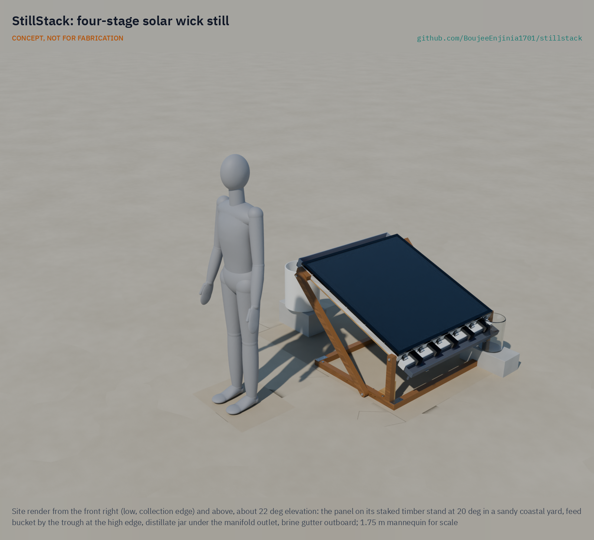
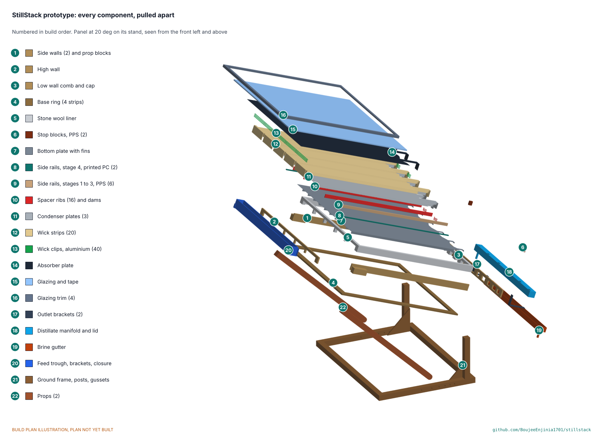

# StillStack

      

**Area:** Water Security · **TRL:** 3 of 9 (proof of concept on paper) · **Value-engineering target:** USD 355 (estimated cost of the constructable design USD 460.70) · **Difficulty:** 3 of 5

Multi-stage wick still that reuses the latent heat of condensation from each stage in the next one.

[Interactive 3D model](media/viewer.html) · [Concept blueprint (PDF)](media/concept-blueprint.pdf) · [General arrangement SSK-DWG-002 (PDF)](cad/drawings/SSK-DWG-002.pdf) · [STEM check](docs/01b-stem-check.md) · [Concept options](docs/02a-concept-options.md) · [Requirements](docs/03-requirements.md) · [Traceability](docs/03b-traceability.md) · [Sizing note SSK-CAL-001](docs/04-calcs/01-sizing.md) · [Prototype build plan](docs/05-build-plan.md) · [Design decisions](docs/06-design-decisions.md) · [Review note](docs/REVIEW.md)

## Concept rationale

A basin still wastes the heat it collects: vapor condenses on the glass and its latent heat goes to the sky. Stacking thin wick stages under metal plates lets each stage condense against the next one, so one day of sun evaporates water about four times over. The approach needs no pumps, electronics or membranes, which keeps it passive and repairable, and the calculated output of about 10.3 L per m2 per day is two to three times a basin still of the same area.

The design is open and garage-buildable because the people who need it most are rarely served by commercial desalination. Sheet aluminum, twin-wall polycarbonate, timber and cloth can be bought or salvaged almost anywhere, and a documented design lets an NGO, school or workshop build, test and adapt it rather than wait for a product.

## Burning platform

In 2024, 2.1 billion people, one in four worldwide, still lacked safely managed drinking water, and 106 million drank untreated surface water ([WHO and UNICEF, 2025](https://www.who.int/news/item/26-08-2025-1-in-4-people-globally-still-lack-access-to-safe-drinking-water---who--unicef)). The WHO estimates that in 2022 at least 1.7 billion people used a drinking water source contaminated with faeces, and that in 2021 over 2 billion people lived in water-stressed countries, a pressure that climate change and population growth are expected to worsen ([WHO drinking-water fact sheet](https://www.who.int/news-room/fact-sheets/detail/drinking-water)).

Many of these households sit beside seawater or above brackish aquifers that they cannot drink. Rising dry-season river salinity is projected across the southwest coast of Bangladesh by 2050 ([World Bank, 2015](https://www.worldbank.org/en/news/feature/2015/02/17/salinity-intrusion-in-changing-climate-scenario-will-hit-coastal-bangladesh-hard)). A still that turns salt water into distillate with sunlight alone, at several times the output of a basin still, addresses both problems at household scale.

## Where it could be used

### By industry

| Industry | Use |
| --- | --- |
| Humanitarian and WASH programs | Household or clinic distillate where only saline or brackish water is available |
| Island and remote tourism | Backup drinking and cooking water for eco-lodges and dive camps without reliable reverse osmosis |
| Off-grid energy | Distilled water for topping up lead-acid batteries in solar home and telecom systems |
| Education and technical training | A hands-on build for courses in heat transfer, water treatment and renewable energy |
| Field research stations | Low-salt water for rinsing instruments and small laboratory needs |

### By country or region

| Country or region | Why it matters there |
| --- | --- |
| Bangladesh (southwest coast) | Dry-season river salinity is projected to rise significantly by 2050, and eight coastal districts are the most affected ([World Bank](https://www.worldbank.org/en/news/feature/2015/02/17/salinity-intrusion-in-changing-climate-scenario-will-hit-coastal-bangladesh-hard)) |
| Kiribati (South Tarawa) | Groundwater from the freshwater lens can support only about half of South Tarawa's population, and households receive piped water for about 1.5 hours every two days ([World Bank](https://blogs.worldbank.org/en/eastasiapacific/drilling-for-water-in-kiribati)) |
| United States (Texas) | Texas aquifers hold about 2.7 billion acre-feet (about 3.3 x 10^12 m3) of brackish groundwater at 1,000 to 10,000 mg/L dissolved solids ([Texas Water Development Board](https://www.twdb.texas.gov/publications/reports/numbered_reports/doc/r363/b2.pdf)); small ranches and colonias could use it at household scale |
| Chile (Antofagasta region, Atacama coast) | The region holds the Atacama, the driest desert in the world, with about 1.7 mm of rain a year in Antofagasta; demand exceeds supply, and about 42 % of the rural population has no formal drinking-water supply ([Ruffino et al., IJERPH, 2022](https://doi.org/10.3390/ijerph192114406)) |
| Middle East and North Africa | The region has the world's lowest water availability per person, about 480 m3 a year in 2023, less than 10 % of the global average ([World Bank](https://blogs.worldbank.org/en/voices/in-mena-make-every-drop-of-water-count)); sun and seawater are plentiful |

## What sparked the idea

The starting point was a floating prototype that researchers at Politecnico di Torino tested in the Ligurian Sea at Varazze, Italy: a stack of thin evaporating and condensing layers fed by porous materials, with no pumps, which produced almost 3 L of distillate per m2 per hour from seawater at less than one sun ([Chiavazzo et al., Nature Sustainability, 2018](https://doi.org/10.1038/s41893-018-0186-x)); the university reported daily productivity of up to 20 L of drinking water per m2 ([Politecnico di Torino release via ScienceDaily](https://www.sciencedaily.com/releases/2019/01/190107131242.htm)). Their shift of attention from absorbing more sunlight to reusing the heat already absorbed is the principle behind StillStack. The gap it points at is that the result was a research device, not a design a community workshop could build; StillStack sets out to be that open, land-based, garage-buildable version.

## Problem

Single-basin solar stills make only about 3 to 5 L per m2 per day.

## Concept

Multi-stage wick still that reuses the latent heat of condensation from each stage in the next one.

The TRL 3 sizing (SSK-CAL-001 v0.9) gives about 10.3 L per m2 per day on a 5.5 kWh per m2 day, with a gained output ratio of 1.22 to 1.29 (the target, restated by Amish on 2026-10-25 for four stages, is 1.2 or more). Dry stagnation reaches about 138 °C (142 °C in calm air), so stages 1 to 3 have PPS rails, the stack materials are rated to 150 °C and a stagnation cover is supplied. Value-engineering target: USD 355. Estimated cost of the constructable design: USD 460.70 (USD 105.70 over the target).

Full design precis: [docs/02-concept.md](docs/02-concept.md)

## STEM check

The [STEM check](docs/01b-stem-check.md) (SSK-STM-001) tests 34 claims of the design and 4 of option B against known physics, chemistry and biology, each with an independent first-order estimate, and an independent reviewer tried to refute them. The working principle holds. Four details failed: two are fixed under Amish's standing instruction of 2026-10-23 (PPS rails in stage 3; the underside and fins painted black after the reviewer showed the underside convection had been over-credited), and two had fixes that Amish decided on 2026-10-25: aluminium in place of stainless wick clips, and anchoring against wind as a hold point, because the unanchored stand tips at about 16.5 m/s. Ten rows stay plausible, to confirm at TRL 4, so the check is open.

## Concept options

The [concept options](docs/02a-concept-options.md) (SSK-OPT-001) weigh the current design (option A, four-stage wick still) against a single-effect tilted wick still (option B), both modelled in detail in `cad/src/model.py`. A makes about 2.7 times the water per panel; B is simpler, uses a glass condensing surface and is easier to clean. They score 152 and 153 of 220, within 10 %, so both go to Amish without a pick (decision D-03); the repo stays on option A until he decides.

## Key components

- Twin-wall polycarbonate glazing
- Insulated plywood frame with a stone wool liner
- Black aluminum absorber and four coated aluminum condenser plates
- Wick strips, four stages
- Side rails (PPS in stages 1 to 3, printed polycarbonate in stage 4) and silicone-cord spacer ribs
- Feed trough, lidded distillate manifold and brine gutter
- Rear heat-rejection fins, painted black with the bottom plate's underside, and an adjustable tilt stand
- Opaque stagnation cover for when the feed runs out

The working bill of materials is in [bom/bom.csv](bom/bom.csv).

## Building the prototype

The [prototype build plan](docs/05-build-plan.md) (SSK-BLD-001) shows how to make each of the 20 components and put them together in 22 illustrated steps. The frame is a plywood box on a plywood base ring, lined with stone wool and closed by twin-wall glazing under an aluminium trim. The five aluminium plates are cut with a zigzag low edge so distillate leaves on tongues at the rib lines and brine on separate tongues over the closed manifold lid. The stand pivots on two front posts and is held by props pinned at one of six holes from 10° to 35°. The changes that made the concept buildable are in [SSK-DDR-003](docs/decisions/0003-design-for-construction.md), and decisions still open are in the [design decisions register](docs/06-design-decisions.md).

## Safety

> Distillate must be tested before drinking. Use food-safe materials on all wetted surfaces. The absorber reaches about 140 °C if the wicks run dry: fit the stagnation cover before maintenance and whenever the feed runs out. Always stake the stand or ballast it with 40 kg before filling (a hold point): unanchored, it can tip over at about 16.5 m/s of wind.

## Repository layout

| Folder | Contents |
| --- | --- |
| `docs/` | Problem, concept, requirements, calculations and design decisions |
| `cad/src/` | build123d Python source, the source of truth for all geometry |
| `cad/step/`, `cad/stl/` | Exported models for FreeCAD, other CAD tools and printing |
| `cad/drawings/` | 2D sketches and dimensioned drawings |
| `bom/` | Bill of materials |
| `electronics/` | KiCad schematics and PCB layouts |
| `firmware/` | Microcontroller code |
| `media/` | Renders, perspectives and photos |
| `build-log/` | Dated prototyping notes |

## Documentation

Controlled documents follow the portfolio [documentation standard](.kit/STANDARDS.md). Each carries a document ID (SSK-PRC-001 for the precis), a version and a revision history. Branded PDFs are built with `python .kit/render.py` and attached to GitHub Releases when a document is tagged, for example `SSK-PRC-001/v1.0`.

## Credits

Designed by Amish Chadha. See [CONTRIBUTORS.md](CONTRIBUTORS.md) for roles. To cite this design, use [CITATION.cff](CITATION.cff) (GitHub shows it as "Cite this repository").

AI assistance (Claude) was used to accelerate concept renders, prototype documentation and first-pass sizing calculations. Design direction and all decisions are Amish Chadha's, recorded in this repository's decision records (`docs/decisions/`).

## Licenses

- **Hardware** (CAD, drawings, BOM, electronics): [CERN-OHL-S v2](LICENSE)
- **Software** (firmware, scripts, notebooks): [MIT](LICENSE-SOFTWARE)

A project of the [Design Molecule](https://designmolecule.com) lab.
