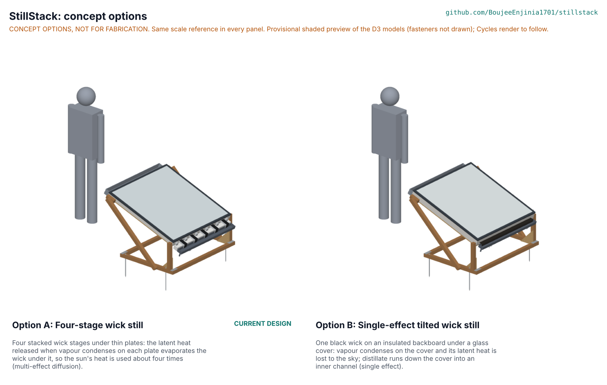

# StillStack concept options

Recommendation: none, by rule. Option A, the four-stage wick still (the current design), scores 152 of 220 and option B, a single-effect tilted wick still, scores 153, a difference of under 1 %, so both go to Amish without a pick (decision D-03 in SSK-DEC-001, argued in SSK-DDR-004). StillStack was designed before kit 1.8, so the current design is option A and nothing here changes it without Amish's go. Method: STANDARDS section 21.

*Figure 1. Both options from their D3 models in `cad/src/model.py`, each with a 1.75 m figure for scale. The picture in the repo is a provisional shaded preview (`cad/src/options_preview.py`, fasteners not drawn) until the Cycles render (`python .kit/options.py`) is made on Amish's Mac.*

## The options

### Option A: four-stage wick still (current design)

Four stacked wick stages under thin plates: the latent heat released when vapour condenses on each plate evaporates the wick under it, so the sun's heat is used about four times (multi-effect diffusion). A 1 m2 tilted panel: twin-wall polycarbonate glazing, a black aluminium absorber, four cloth wick stages with 6 mm vapour gaps held by PPS and polycarbonate rails and silicone ribs, five shaped aluminium plates with distillate and brine tongues, painted fins, a feed trough, a lidded distillate manifold and a brine gutter, on a timber tilt stand (SSK-PRC-001). First-order numbers: 10.3 L/m2/day on the design day (SSK-CAL-001 v0.8), USD 460.70 in parts, 18.8 kg dry (CAL). Key risks: wick permeability and heat rating, a food-contact coating certificate, carryover paths between brine and distillate, a gained output ratio of 1.22 against the 1.2 now required (restated by Amish on 2026-10-25), and cost. From a co-design partner it needs distillate quality testing per stage and a wicking-rise test of the fabrics.

### Option B: single-effect tilted wick still

One black wick on an insulated backboard under a glass cover: vapour condenses on the cover and its latent heat is lost to the sky; distillate runs down the cover into an inner channel (single effect). The same 1,074 mm frame, feed trough, brine gutter and stand as option A: a plywood box on a plywood base panel, a 25 mm stone wool backboard and liners, a black aluminium tray and one black cotton-viscose wick clamped at its high end, a 4 mm toughened glass cover 60 mm above the wick on foam tape under the same mitred trim, a silicone drip strip under the glass leading condensate into a PP channel inside the low wall with an outlet tube through the side wall, and the wick's ends running out through slots to the trough and the brine gutter. First-order numbers: about 3.8 L/m2/day at an assumed 45 % daily efficiency (STEM rows B1 and B2; tilted wick stills in the literature give 4.5 to 5.0 L/m2/day), so about 2.6 panels for 10 L a day; about USD 227 per panel (estimate from option A's BOM lines for the shared parts, the absorber line for the tray, the manifold line for the channel, and the glazing line for the glass, whose price is to assess); panel about 31 kg in the D3 model (11 kg of it the glass). Key risks: glass breakage, a heavier panel than PR-009 allows, the same 150 °C wick rating as option A (B3). From a co-design partner it needs the same distillate testing, and a view on whether households would rather have more, simpler panels.

## First-order numbers

Table 1. Options compared.

| Quantity | Option A | Option B |
| --- | --- | --- |
| Estimated parts cost (USD) | 460.70 per panel (BOM); about 461 for 10 L/day | About 227 per panel (estimate, glass to price); about 590 for 10 L/day (2.6 panels) |
| Mass (kg) | 18.8 dry panel (CAL); D3 model 19.8 panel and 10.2 stand, 29.9 in all (kit densities) | About 31.5 panel and 10.2 stand, 41.7 in all (D3 model, kit densities) |
| Output | 10.3 L/m2/day (10.9 quasi-steady) | About 3.8 L/m2/day (assumed 45 % efficiency) |
| Energy or effort | Passive; fill the feed daily, rinse 20 wick strips weekly | Passive; fill the feed daily, rinse one wick weekly |
| Parts count (D3 model) | 293 (174 made or bought, 119 fasteners) | 159 (51 made or bought, 108 fasteners) |
| STEM check | Within known science; S16 and S30 fixes with Amish; ten rows plausible | Within known science; B3 plausible |

## Scoring

Table 2. Weighted scoring (weights: High UR 3, Medium 2, Low 1; scores 1 to 5).

| Criterion | Source | Weight | A | B | Reason |
| --- | --- | --- | --- | --- | --- |
| Enough water from one panel | UR-001 | 3 | 4 | 1 | A gives 10.3 L from one panel, just over the need; B needs 2.6 panels |
| Better than a basin still | UR-002 | 3 | 5 | 2 | A two to three times a basin still; B about the same as a good basin or wick still |
| Low-salt distillate | UR-003 | 3 | 3 | 4 | A has many carryover paths at tongues, lips and gaps; B one wick, one cover and an air gap to the channel |
| Brine never reaches drinking water | UR-004 | 3 | 3 | 4 | A relies on 10 mm breaks and lip tabs at 20 places; B separates by geometry at one edge |
| No power or fuel | UR-005 | 3 | 5 | 5 | Both passive |
| Real feed water | UR-006 | 3 | 3 | 4 | A needs a high-permeability wick in narrow gaps; B one open wick, easy to flush |
| Safe materials | UR-007 | 3 | 3 | 5 | A needs a certified coating on hot aluminium; B condenses on glass into PP |
| Survives a dry day | UR-008 | 3 | 3 | 4 | Both reach about 140 °C; A has more polymers in the hot zone |
| Two people can move it | UR-009 | 2 | 4 | 2 | A 18.8 kg dry; B about 31 kg with its glass |
| Easy cleaning | UR-010 | 2 | 3 | 5 | A: lift five plates, 20 strips, 40 clips; B: lift the glass, one wick |
| Works at my latitude | UR-011 | 2 | 5 | 5 | Same stand, 10 to 35 deg |
| Affordable and buildable locally | UR-012 | 3 | 3 | 3 | A costs less per litre but is harder to build; B simpler but more panels |
| Stays put and does not burn | UR-013 | 3 | 4 | 3 | A light (needs anchoring); B heavier but has a glass breakage hazard |
| Cost against the value-engineering target | PR-012 | 2 | 2 | 1 | Per 10 L/day: A USD 461, B about USD 590, both over USD 355 |
| Buildable with local skills and tools | BLD | 2 | 2 | 4 | A: shaped plates, tongues, clips, a coater; B: box, glass, one wick |
| Safety | RSK | 3 | 3 | 3 | A hot stack and carryover risk; B glass and the same hot wick |
| Maintenance | PR-010 | 1 | 3 | 5 | As UR-010 |
| **Weighted total (of 220)** | | | **152** | **153** | Within 10 %: both to Amish |

## Recommendation

No pick: the options are within 10 %, so both go to Amish (SSK-DEC-001 D-03, SSK-DDR-004). The choice turns on what matters most. Water per household for the money and the effort of building favours A (one panel and USD 461 for 10 L a day against 2.6 panels and about USD 590). The lowest risk to drinking-water safety and the easiest care favour B. The runner-up's best idea to graft onto A, if A is kept, is B's glass cover: glass in place of twin-wall polycarbonate removes the 120 °C glazing limit (STEM S13) but adds about 9 kg, past the 20 kg of PR-009, so it is not proposed now. If B were chosen, A's best idea to graft onto it is a second stage under the wick, which would make it a two-stage still and is a design change for a later session.
